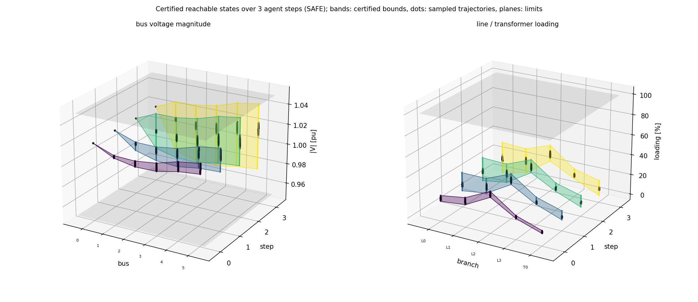

# GridBound

**`certflow`: an independent safety auditor for learned power-grid controllers.**

The result is a mathematical certificate, not a statistical estimate. It holds for every operating condition
in a given set, with floating-point rounding included.

What it can audit:

- **Continuous dispatch controllers** (loads → generator setpoints). certflow proves that the AC power flow has a
  **unique** solution for every load in the set, and bounds every operational quantity: bus voltages, generator
  active and reactive power, slack power, branch currents or loadings, and angle differences. If a limit can be
  violated, it computes a certified constant correction of the setpoints, piecewise over the set if needed.
- **Discrete-action agents (RL).** certflow proves which actions the agent can take for every load in a set. It then
  checks whether each such action keeps the grid within its limits one step later, in the intact grid (N-0) and after
  any single line outage (N-1), and builds multi-step trees of the action sequences that can occur.
- **Robustness to measurement noise.** certflow computes the largest sensor-noise level for which the agent's
  decision provably stays the same, or provably stays safe, together with a concrete noise vector that breaks it.

Every case study also runs an independent Monte-Carlo check of the certified claims.

The RL case study audits the agent of [*Multi-Objective Deep Reinforcement Learning for Secure and Stable Power System
Operation*](https://arxiv.org/abs/2608.20914) (Papadopoulos, Tsaousoglou, Vorwerk).


## Documentation

- [docs/modes/](docs/modes/README.md): **start here**: how to set up an audit, and one page per mode (dispatch NN, RL next-step, RL noise, RL multi-step) with usage, results and figures
- [docs/method.md](docs/method.md): how the proofs work, for readers who want the mathematics

## Install

Requires Python ≥ 3.9. The core depends only on numpy and scipy. Tested with Python 3.10, numpy 2.2, scipy 1.15,
pandapower 3.5, torch 2.14 and matplotlib 3.10.

```bash
git clone https://github.com/bastiengiraud/GridBound.git
cd GridBound
python -m venv .venv && source .venv/bin/activate
pip install -e .              # numpy + scipy
pip install -e ".[all]"       # + pandapower, torch, matplotlib, pytest (for certflow.audit, from_torch, plots, tests)
```

## Quick start: `certflow.audit`

Describe the grid, the controller and the limits in pandapower terms. Every result is SAFE (proven), UNSAFE (with a
concrete counterexample) or NOT PROVEN. Setup and one page per mode, with results and figures: [docs/modes/](docs/modes/README.md).

```python
from certflow.audit import GridModel, Limits, RLAuditor, act, obs, verify_dispatch

# an RL agent that reads the grid state and switches taps / sgen setpoints
model = GridModel(net,
                  observation=[obs.bus_vm(), obs.line_loading(), obs.trafo_loading(), obs.sgen_p(), obs.trafo_tap()],
                  actions=[act.idle(), act.shift_tap(0, -1), act.shift_tap(0, +1), act.set_sgen(3, q_mvar=0.5)],
                  limits=Limits(vm_pu=(0.95, 1.05), max_loading_percent=100))
model.check_against_pandapower()                       # the model must read the grid like the agent's env
auditor = RLAuditor(policy, model)                     # torch module or SB3 model
print(auditor.next_step(net, load_width=0.05))         # mode 1: every action it can take, safe one step later?
print(auditor.noise_robustness(net))                   # mode 2: how much measurement noise until it misbehaves?
auditor.multi_step(net, steps=3).plot("reachable.png") # mode 3: certified reachable states over 3 steps, in 3D

# an NN trained on OPF data: loads -> (Pg, Vg)
print(verify_dispatch(net, opf_model, load_width=0.10, restore=True))
```

Runnable (outputs saved next to each script as `*_output.txt`):
`python examples/pandapower_rl_audit.py` (modes 1 and 2 on CIGRE MV with taps and sgens),
`python examples/multistep_reachability.py` (mode 3 on a small feeder, writes the 3D plot below) and
`python examples/opf_dispatch_audit.py` (an NN trained on OPF data). What changed in this version: [CHANGELOG.md](CHANGELOG.md).



## Lower-level API

```python
from certflow.nn import from_torch                       # or from_state_dict / sb3_actor / layers by hand
from certflow.power import (from_pandapower, DispatchController, PFVerifier, default_constraints,
                            Restorer, monte_carlo)
from certflow.sets import low_rank_load_set

grid = from_pandapower(net)                              # solved net (or from_matpower("case.m"))
ctrl = DispatchController(from_torch(model), grid.ng, pg_active=..., vg_clip=(vmin, vmax))
U    = low_rank_load_set(x0, Gdirs, frac)                # x = x0 * (1 + frac * Gdirs e), e in [-1,1]^K
ver  = PFVerifier(grid, ctrl, U, default_constraints(grid, vmin, vmax))

cert = ver.certify()                                     # Certificate: .formal, .safe, .bands, .summary()
monte_carlo(ver, cert, n=500)["sound"]                   # independent sampling check
root, leaves = Restorer(ver).restore_split(max_split=8, nproc=4)   # piecewise offsets, each re-certified
```

Parallel: `with ObjectPool(ver, nproc) as pool: ver.certify(pool=pool)` and `Restorer(ver).restore_split(nproc=...)`.
Workers receive the pickled verifier once, so this works with Windows' *spawn*. Guard scripts with
`if __name__ == "__main__":`. Pin BLAS threads (`OMP_NUM_THREADS=1` etc.) for bitwise run-to-run determinism.

## Case study: auditing an RL agent on the WSCC 9-bus system

The example audits a MaskablePPO agent (stable-baselines3) that redispatches generators, changes voltage setpoints
and switches lines on the WSCC 9-bus system. The auditor uses only:

- the trained weights;
- the definitions of the observation, the actions and the mask;
- the grid data (`WSCC_9_bus.raw`, the training environment's PSS/E file);
- the grid limits.

```bash
python examples/wscc9_actor_reachability.py --list-ops          # the six operating points
python examples/wscc9_actor_reachability.py --quick             # all studies, small boxes: about 2 min
python examples/wscc9_actor_reachability.py                     # all studies, full settings: tens of minutes, < 2 GB RAM
python examples/wscc9_actor_reachability.py --study noise --ops 0 4    # one study, some operating points
python examples/wscc9_actor_reachability.py --require-n1        # also require N-1 security for an action to count as safe
python examples/wscc9_actor_reachability.py --study two-step --track both --step-change common   # re-boxing vs history tracking
```

**Grid limits checked**, the same in the intact grid (N-0) and after every line outage (N-1):

- the power flow has a unique solution (no islanding, no collapse);
- every line and transformer loading is at or below its rating;
- |V| is within [0.95, 1.05] pu at every bus;
- the slack generator's active power is within [0, 250] MW.

**Studies**

- **Reachability over load uncertainty:** for every load in a box around an operating point, the certified set of
  actions the agent takes, and for each action a certified verdict on N-0 safety and N-1 security. When an action is
  not N-1 secure, the output names the outage and the violated quantity.
- **Multi-step reachability:** every sequence of actions the agent can take from the box, each step certified. The
  uncertainty is either re-boxed at every step or tracked with new symbols per step (`--track rebox|history|both`).
- **Measurement noise:** the certified and falsified noise radius for "same action" and for "safe action", overall
  and per measurement group.

`examples/wscc9_case_studies_output.txt` and `examples/wscc9_noise_robustness_output.txt` are reference outputs
(`--quick` settings). `examples/wscc9_env.py` models the environment: the loads are constant admittances, and the
observed quantities are power-flow outputs. The model reproduces the observation stored with the trained agent to
float32 precision. The generic parts (`enclose_pf`, `Shunt`, `quantities`, `n1_analysis`, `DiscretePolicyVerifier`,
`MultiStepVerifier`, `robustness_radius`) apply to other grids and agents. Only the observation layout, the action
effects and the mask are specific to this example.

## Assumptions

The certificates assume double-precision arithmetic with round-to-nearest, and math-library functions (`atan2`,
`tanh`, `cosh`, `exp`) accurate to a few ulp. The deployed network's own arithmetic (e.g. float32) is covered by an
explicit error term. The guarantees concern the steady-state AC power flow. See
[docs/method.md](docs/method.md#10-assumptions).
