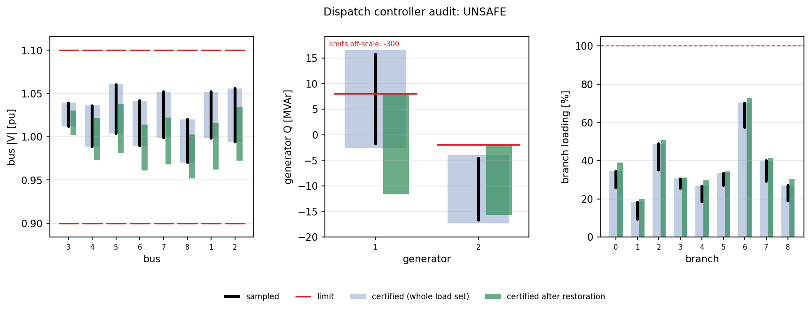

# Dispatch NN (an OPF proxy)

**Question:** a network maps loads to generator setpoints (Pg, Vg). Does the AC power flow keep every operational
limit for **every** load in a set? If not, which constant correction of the setpoints makes it safe?

## Usage

```python
from certflow.audit import verify_dispatch

rep = verify_dispatch(net, model, load_width=0.10)                # pandapower net, MATPOWER case or Grid
rep = verify_dispatch(net, model, load_width=0.10, restore=True)  # + certified setpoint correction
print(rep.summary())
rep.plot("dispatch.png")
```

Declare your network's layout instead of reshaping the network:

| Argument | Values |
|---|---|
| `inputs` | `"pd_qd"` (default), `"pd"`, or indices into `[Pd; Qd]` |
| `input_units`, `pg_units` | `"MW"` or `"pu"` |
| `outputs` | `("pg", "vg")` (default), `("vg", "pg")`, `("pg",)` or `("vg",)`; a missing block stays at its setpoint |
| `pg_gens` | which generators' Pg the network outputs |
| `vg_clip` | the deployed Vg saturation, if any |
| `load_set` | any `AffineSet` over `[Pd; Qd]`, e.g. `certflow.sets.low_rank_load_set`; default: each load ±`load_width` |
| `vm_pu`, `constraints` | the limits; default: \|V\|, Pg, Qg, slack P/Q, branch current, angle difference |

## How it works

1. The load set is pushed through the network: the setpoints are now known as functions of the loads.
2. Krawczyk proves that the power flow has a unique solution for every load and encloses the grid state.
3. Every limited quantity is bounded on that enclosure. Where the proof fails, the load set is split and each part is
   certified on its own.
4. With `restore=True`, a QP finds a constant setpoint offset that moves every bound inside its limit, and the
   offset is re-certified. The set is split when one offset is not enough.

## Example: case9 with tight reactive limits

The loads vary by ±10 % each. Both PV generators have tight reactive limits (Qmax = 8 and −2 MVAr).

<!-- report:dispatch -->
```text
DISPATCH CONTROLLER AUDIT  ->  UNSAFE
  load set: 3 loads, 3 uncertain directions; power flow certified (unique solution) on 1 box(es), max rho 0.116
  certified range over the whole load set vs limit:
    V            0.97 .. 1.06       pu    limits [0.9, 1.1]   ok
    Pg          76.53 .. 179.3      MW    limits [10, 300]   ok
    Qg          -17.3 .. 16.51      MVAr  limits [-300, 8]   CAN BE VIOLATED   worst excess 8.51 MVAr at element 1
    slack       2.158 .. 80.42      MW/MVAr limits [-300, 300]   ok
    branch loading  max 70.4% (branch 6)   limit 100%   ok
  Monte-Carlo cross-check (300/300 converged samples): every sample inside the certified ranges: True; limit families violated by a sample: 1
  restoration: 1/1 box(es) made certifiably safe with a constant setpoint correction:
    e in [[-1. -1. -1.], [1. 1. 1.]]: SAFE  dPg = [-0.117 -0.031] MW, dVg = [-0.0363 -0.0218] pu
  time 4.7s
```
<!-- /report -->



How to read it:

- **Blue:** the certified range.
- **Black:** the range the sampled loads reach.
- **Red:** the limits.
- **Green:** the certified range after the correction.

Generator 1's Q can exceed its 8 MVAr limit, and a sample confirms it: the verdict is UNSAFE. A slight reduction of
both Vg makes the whole load set certifiably safe.

For branch loading, only the upper bound is certified.

**Not covered:** dynamics (steady-state AC power flow only), and loads outside the set.
