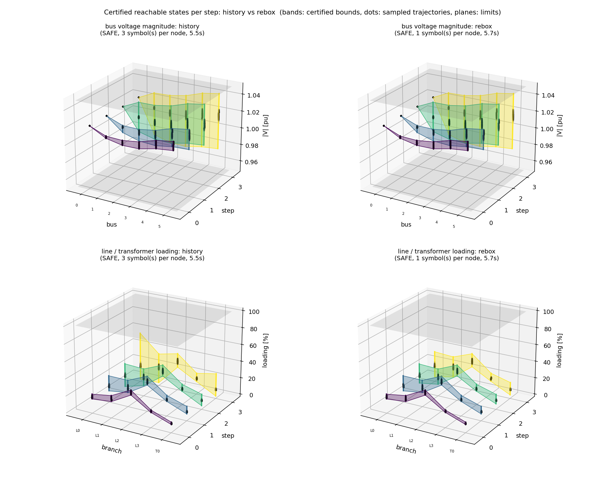

# RL mode 3: multi-step reachability

**Question:** the loads start anywhere in a set and keep changing between the agent's actions. Which action
sequences can the agent take over the next k steps, which grid states (voltages, loadings) can it reach, and do they
all stay within the limits?

## Usage

```python
from certflow.audit import LoadUncertainty, compare_3d, width_table

rep = auditor.multi_step(net, uncertainty=LoadUncertainty(rel=0.10, directions="common"),
                         steps=3, step_change=0.03)     # loads +-10 % at the start, then +-3 % per step
print(rep.summary())
rep.plot("reachable.png")                               # 3D: element x step x certified band
rep.tree.paths()                                        # every reachable action sequence

compare_3d({"history": rep_h, "rebox": rep_r}, "compare.png")   # two runs side by side
print(width_table({"history": rep_h, "rebox": rep_r}))          # widest band per step
```

Options:
- `track`: `"rebox"` (default) or `"history"` (see below);
- `max_depth`: the splitting budget per step;
- `n_check`: the number of sampled trajectories.

## How it works

- **The loads are a set, not one realisation.** The set at step k+1 is the set at step k with a full ±`step_change`
  box added around every point. With ±10 % and ±3 %, after k steps the loads can be anywhere within ±(10 + 3k) %.
  Single realisations appear only in the sampled trajectories (the dots in the figures).
- **Each step** is the [mode-1](rl_next_step.md) pipeline:
  1. certify the grid over the current load set;
  2. find every action the agent can take;
  3. certify the grid after each action over the next load set.
- **Actions branch.** Different actions lead to different tap positions or setpoints, and the next power flow depends
  on them, so each action gets its own branch. A branch starts from the part of the load set where the agent takes
  that action.
- **The plot is a union.** Each branch keeps its own bounds (`rep.tree`). The envelope per step, as printed and
  plotted, is the union over all branches: every state the grid can be in after k actions, whatever the agent chose.

The result is a formal over-approximation of every trajectory of the deployed agent under the load model. If any
power flow along the way cannot be certified, the verdict cannot be SAFE.

## Example: the feeder, 3 steps

<!-- report:rl_multistep_rebox -->
```text
MULTI-STEP REACHABILITY AUDIT (3 steps)  ->  SAFE
  loads: low-rank: all loads together at step 0, then +-3% per step (tracking: rebox, 1 symbols per node at most)
  limits: |V| in [0.95, 1.05] pu, loading <= 100%, N-0
  tree: 11 nodes, 12 boxes; 38 reachable action sequence(s):
    idle -> idle -> idle
    idle -> idle -> trafo 0 tap +1
    idle -> idle -> trafo 0 tap -1
    idle -> idle -> sgen 1 Q=-1 MVAr
    idle -> idle -> sgen 1 Q=0 MVAr
    idle -> trafo 0 tap +1 -> idle
    idle -> trafo 0 tap +1 -> trafo 0 tap +1
    idle -> trafo 0 tap +1 -> trafo 0 tap -1
    idle -> trafo 0 tap +1 -> sgen 1 Q=-1 MVAr
    idle -> trafo 0 tap +1 -> sgen 1 Q=0 MVAr
    idle -> trafo 0 tap -1 -> idle
    idle -> trafo 0 tap -1 -> trafo 0 tap +1
    ... (+26)
  certified envelope per step (union over every reachable sequence):
    step 0 (before any action): |V| 1.0059..1.0230 pu, max loading   35.4%   all limits kept
    step 1 (after action 1   ): |V| 0.9975..1.0245 pu, max loading   38.9%   all limits kept
    step 2 (after action 2   ): |V| 0.9883..1.0416 pu, max loading   39.9%   all limits kept
    step 3 (after action 3   ): |V| 0.9720..1.0431 pu, max loading   41.6%   all limits kept
  Monte-Carlo (200 trajectories of the deployed agent): action sequence in certified set 200/200, every state inside the certified envelope 200/200, trajectories with a real limit violation 0
  time 5.7s
```
<!-- /report -->


How to read it:

- **x:** the bus (left) or branch (right);
- **y:** the step: 0 is before any action, k is after the k-th action;
- **bands:** the certified range;
- **dots:** sampled trajectories;
- **grey planes:** the limits.

The bands widen with every step: the load set grows, and every new branch adds its own voltage profile. All three
steps stay within the limits.

## History or rebox tracking

There are two ways to carry the load set from one step to the next:

| | `"history"` | `"rebox"` (default) |
|---|---|---|
| next load set | the earlier symbols, plus **new symbols** for each step change | a box in the load set's own directions, widened by the step change |
| symbols per step | grow: K + k·r after k steps | stay K |
| when to use it | when the step change has directions of its own | when it moves along the load set's directions (the usual case) |

**Rebox is never looser here.** In steady state the grid has no memory: at each step it depends only on the current
loads and the current taps / setpoints, not on how the loads got there.
- **History** keeps the step symbols separate but uses only their sum, and takes the hull before summing.
- **Rebox** takes the hull after summing, which is never larger, and keeps the dimension fixed.



**Widest certified band per step:**

<!-- report:rl_multistep_widths_timing -->
| step | max voltage band width [pu], history | max voltage band width [pu], rebox | max loading band width [%], history | max loading band width [%], rebox |
|---|---|---|---|---|
| 0 | 0.0102 | 0.0102 | 7.0 | 7.0 |
| 1 | 0.0230 | 0.0230 | 18.2 | 18.2 |
| 2 | 0.0473 | 0.0473 | 28.0 | 23.5 |
| 3 | 0.0654 | 0.0653 | 57.1 | 31.4 |
<!-- /report -->

What the figure and the table show:

- **Same tree:** both modes find the same 38 action sequences, and all 200 sampled trajectories lie inside both.
- **Voltages:** the bands are identical. The widest one roughly doubles per step (0.010 → 0.065 pu).
- **Loadings:** the modes split from step 2. At step 3 the widest band is 31 % with rebox and 57 % with history.
- **Bands vs dots:** the bands are much wider than the dots because they cover all 38 sequences, most of which the
  agent rarely takes. That is not looseness of the bounds.

## Cost: what limits the horizon

Measured on the feeder (single runs, one core, no sampling):

<!-- report:rl_multistep_timing -->
| steps | tracking | time [s] | tree nodes | boxes | symbols per node (max) | reachable sequences | max loading after last action [%] | verdict |
|---|---|---|---|---|---|---|---|---|
| 1 | history | 0.3 | 1 | 1 | 1 | 2 | 38.9 | SAFE |
| 1 | rebox | 0.3 | 1 | 1 | 1 | 2 | 38.9 | SAFE |
| 2 | history | 1.0 | 3 | 3 | 2 | 8 | 39.9 | SAFE |
| 2 | rebox | 1.0 | 3 | 3 | 1 | 8 | 39.9 | SAFE |
| 3 | history | 10.2 | 11 | 12 | 3 | 38 | 57.1 | SAFE |
| 3 | rebox | 11.4 | 11 | 12 | 1 | 38 | 41.6 | SAFE |
| 4 | history | 48.3 | 49 | 70 | 4 | 186 | 65.2 | NOT PROVEN |
| 4 | rebox | 14.0 | 49 | 57 | 1 | 178 | 43.6 | SAFE |

Measured with `python docs/make_figures.py rl3_timing` on Intel64 Family 6 Model 186 Stepping 3, GenuineIntel, single process, nothing else running.
<!-- /report -->

- **The tree is the bottleneck.** Nodes grow about 4–5× per step (1 → 3 → 11 → 49), and time follows. A 5-step run
  did not finish within 10 minutes.
- **Symbol growth is the second cost, and only with history.** More symbols per node make every power-flow proof
  more expensive, and splitting needs more boxes.
  - **Up to 3 steps:** history has few extra symbols here, and both modes take about the same time.
  - **At 4 steps:** history takes 48 s and leaves one box undecided (NOT PROVEN). Rebox takes 14 s and is SAFE.
- **Memory is not the bottleneck.** A node stores a few kilobytes here, and about 15 MB on a 1000-bus grid with 30
  symbols.

To go further:

- keep rebox;
- use few load directions and small step changes, which give fewer actions per step;
- merge branches that reach the same taps and setpoints (for example tap +1 then −1 equals idle, idle). This is not
  implemented yet.

**Not covered:** dynamics between actions, loads outside the initial set, and loads moving faster than
`step_change`.
