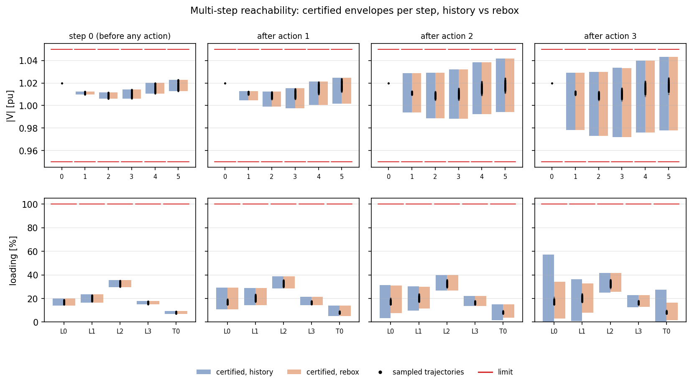

# RL mode 3: multi-step reachability

**Question:** the loads start anywhere in a set and keep changing between the agent's actions. Which sequences of
actions can the agent take, and which grid states (voltages, loadings) can it drive the grid into over the next k
steps? Is every one of them within the limits?

## API

```python
from certflow.audit import LoadUncertainty, compare_3d, compare_multistep, width_table

rep = auditor.multi_step(net, uncertainty=LoadUncertainty(rel=0.10, directions="common"),
                         steps=3, step_change=0.03)          # track="rebox" (default) or "history"
print(rep.summary())
rep.plot("reachable.png")                                    # 3D: element x step x certified band
rep.envelopes[2].select("vm")                                # raw certified bounds after the 2nd action
rep.tree.paths()                                             # every reachable action sequence

runs = {"history": rep_h, "rebox": rep_r}
compare_3d(runs, "compare3d.png")          # the 3D views side by side, same axes
compare_multistep(runs, "compare.png")     # 2D: per step and element, the bands next to each other
print(width_table(runs))                   # markdown table: widest certified band per step
```

| Option | Meaning |
|---|---|
| `uncertainty` / `load_width` | the load set at step 0 |
| `step_change` | how far the loads can move (relative, ±) between two actions, along the same directions |
| `steps` | the horizon: the number of actions |
| `track` | `"rebox"` (default) or `"history"`; see [Tracking](#tracking-the-loads-from-step-to-step-history-or-rebox) |
| `max_depth`, `max_leaves` | the splitting budget per node of the tree |
| `n_check` | Monte-Carlo trajectories of the deployed agent (0 = skip) |

## How it works

### The load set at every step

The load set is propagated as a **set**, not as one realisation:

- **Step 0:** the loads are anywhere in X₀ = {c + G·e₀ : e₀ ∈ [−1, 1]ᴷ}.
- **Each action:** the loads move by up to ±`step_change`, so X_{k+1} = X_k ⊕ step box. That is a Minkowski sum: a
  full step box around **every** point of X_k.
- **After k steps,** with `directions="common"` and ±10 % / ±3 %, the loads can be anywhere within ±(10 + 3k) %.
  Each branch only keeps the part of that set where the agent's earlier choices actually lead to it (see below).

Single realisations appear only in the Monte-Carlo check: one random start, then one random change per step. Those
are the dots in the figures.

### One step of the tree

At a node (a discrete grid state, i.e. taps and setpoints, plus the load set X_k of that branch):

1. **Pre-action grid:** Krawczyk certifies the power flow over X_k, and the observation is built as a Taylor model.
2. **Agent:** the observation is pushed through the agent, and the masked argmax gives the set of actions it can
   take. X_k is split where several actions compete.
3. **Post-action grid:** for every reachable action a, the grid after a is certified over X_k ⊕ step box. This gives
   two-sided bounds on every |V| and loading after the (k+1)-th action, and the safety verdict for a.
4. **Branching:** every reachable action a gets its own child node with its own discrete state. The child's load set
   is the part of X_k where a is reachable (the hull of those boxes), ⊕ the step box.

### Branch, then take the union

Branching is required: different actions lead to different discrete states (another tap position, another
setpoint), and the next power flow depends on that state. So the ranges of different actions cannot be merged
before the next step.

The union happens only at the end, for reporting:
- **Per sequence:** every branch keeps its own certified bounds in the tree (`rep.tree`).
- **Per step:** the envelope is the union over all branches at that depth. It answers "every state the grid can be
  in after k actions, whatever the agent chose". The text report and the figures show these envelopes.

### Why this is a formal guarantee

The tree over-approximates every trajectory of the deployed agent under the load model:
- every reachable action is included (sound argmax over a sound observation set);
- every child's load set contains every load that can follow;
- every bound comes from a Krawczyk enclosure that also proves the power flow has a unique solution.

If any box's power flow cannot be certified, that step's envelope is marked incomplete and the verdict cannot be
SAFE.

The assumptions are the same as for one step:
- steady-state AC power flow, with no dynamics between actions;
- a deterministic agent (argmax), float32 rounding included;
- the observation model matches the environment.

## Example: the feeder, 3 steps

All loads move together: ±10 % at step 0, then ±3 % before each further action.

**Rebox (default):**

<!-- report:rl_multistep_rebox -->
```text
MULTI-STEP REACHABILITY AUDIT (3 steps)  ->  SAFE
  loads: low-rank: all loads together at step 0, then +-3% per step (tracking: rebox, 1 symbols per node at most)
  limits: |V| in [0.95, 1.05] pu, loading <= 100%, N-0
  tree: 11 nodes, 12 boxes; 38 reachable action sequence(s):
    idle -> idle -> idle
    idle -> idle -> trafo 0 tap +1
    idle -> idle -> trafo 0 tap -1
    idle -> idle -> sgen 1 Q=-1 MVAr
    idle -> idle -> sgen 1 Q=0 MVAr
    idle -> trafo 0 tap +1 -> idle
    idle -> trafo 0 tap +1 -> trafo 0 tap +1
    idle -> trafo 0 tap +1 -> trafo 0 tap -1
    idle -> trafo 0 tap +1 -> sgen 1 Q=-1 MVAr
    idle -> trafo 0 tap +1 -> sgen 1 Q=0 MVAr
    idle -> trafo 0 tap -1 -> idle
    idle -> trafo 0 tap -1 -> trafo 0 tap +1
    ... (+26)
  certified envelope per step (union over every reachable sequence):
    step 0 (before any action): |V| 1.0059..1.0230 pu, max loading   35.4%   all limits kept
    step 1 (after action 1   ): |V| 0.9975..1.0245 pu, max loading   38.9%   all limits kept
    step 2 (after action 2   ): |V| 0.9883..1.0416 pu, max loading   39.9%   all limits kept
    step 3 (after action 3   ): |V| 0.9720..1.0431 pu, max loading   41.6%   all limits kept
  Monte-Carlo (200 trajectories of the deployed agent): action sequence in certified set 200/200, every state inside the certified envelope 200/200, trajectories with a real limit violation 0
  time 5.7s
```
<!-- /report -->


In the 3D view:
- **x:** the bus (left) or branch (right);
- **y:** the step: 0 is before any action, k is after the k-th action;
- **bands:** the certified range;
- **dots:** sampled trajectories;
- **grey planes:** the limits.

The envelopes widen with each step, because the load set grows by ±3 % and the agent's taps and reactive power
change the voltage profile. All 3 steps stay within the limits: the verdict is SAFE.

## Tracking the loads from step to step: history or rebox

The toolbox (`certflow.policy.MultiStepVerifier`) has two ways to carry the load set from one step to the next.

| | `track="history"` | `track="rebox"` |
|---|---|---|
| Next load set | the previous symbols, restricted to the boxes where the action is reachable, plus **new symbols** for the step change | the box of the previous load set **in the set's own coordinates**, widened by the step change |
| Symbols per node | K + k·r after k steps (r = symbols per step change) | K, constant |
| Correlation between steps | kept in the symbols | kept implicitly (see below) |
| Works when | always | the step change moves along the set's own directions (the case for `LoadUncertainty`) |

**Why rebox loses nothing here:** the steady-state grid has no memory. The pre-action grid at step k depends only on
the current loads and the discrete state of the branch, not on how the loads got there.

- **History:** the symbols e₀, w₁, …, w_k enter the grid only through their sum x_k = c + G(e₀ + s·w₁ + … + s·w_k)
  (with modes or per-load boxes, each step moves along the columns of G, scaled by s).
- **Rebox:** works directly in the coordinates e' = e₀ + s·w₁ + …. It keeps the interval hull of e' over the boxes
  where the action is reachable, then widens it by s.

The history child set, seen through that sum, is the projection of a hull. The rebox set is the hull of the
projections, which is never larger. So **rebox is never looser than history for this load model, and its dimension
does not grow.**

History tracking is needed when the step change has directions of its own, for example a low-rank initial set with
independent per-load step noise. The grid model can't use rebox in that case, and `multi_step` raises an error
pointing to `track="history"`.

<!-- report:rl_multistep_history -->
```text
MULTI-STEP REACHABILITY AUDIT (3 steps)  ->  SAFE
  loads: low-rank: all loads together at step 0, then +-3% per step (tracking: history, 3 symbols per node at most)
  limits: |V| in [0.95, 1.05] pu, loading <= 100%, N-0
  tree: 11 nodes, 12 boxes; 38 reachable action sequence(s):
    idle -> idle -> idle
    idle -> idle -> trafo 0 tap +1
    idle -> idle -> trafo 0 tap -1
    idle -> idle -> sgen 1 Q=-1 MVAr
    idle -> idle -> sgen 1 Q=0 MVAr
    idle -> trafo 0 tap +1 -> idle
    idle -> trafo 0 tap +1 -> trafo 0 tap +1
    idle -> trafo 0 tap +1 -> trafo 0 tap -1
    idle -> trafo 0 tap +1 -> sgen 1 Q=-1 MVAr
    idle -> trafo 0 tap +1 -> sgen 1 Q=0 MVAr
    idle -> trafo 0 tap -1 -> idle
    idle -> trafo 0 tap -1 -> trafo 0 tap +1
    ... (+26)
  certified envelope per step (union over every reachable sequence):
    step 0 (before any action): |V| 1.0059..1.0230 pu, max loading   35.4%   all limits kept
    step 1 (after action 1   ): |V| 0.9975..1.0245 pu, max loading   38.9%   all limits kept
    step 2 (after action 2   ): |V| 0.9883..1.0416 pu, max loading   39.9%   all limits kept
    step 3 (after action 3   ): |V| 0.9720..1.0431 pu, max loading   57.1%   all limits kept
  Monte-Carlo (200 trajectories of the deployed agent): action sequence in certified set 200/200, every state inside the certified envelope 200/200, trajectories with a real limit violation 0
  time 5.5s
```
<!-- /report -->

### History vs rebox on the feeder (3 steps)


Left column: history; right column: rebox. The z-axes are the same, so the bands compare directly. The panel titles
give the verdict, the symbols per node and the run time.

**How wide the certified bands get, per step** (widest band over all buses / branches):

<!-- report:rl_multistep_widths_timing -->
| step | max voltage band width [pu], history | max voltage band width [pu], rebox | max loading band width [%], history | max loading band width [%], rebox |
|---|---|---|---|---|
| 0 | 0.0102 | 0.0102 | 7.0 | 7.0 |
| 1 | 0.0230 | 0.0230 | 18.2 | 18.2 |
| 2 | 0.0473 | 0.0473 | 28.0 | 23.5 |
| 3 | 0.0654 | 0.0653 | 57.1 | 31.4 |
<!-- /report -->

What the figure and the table show:

- **Same tree:** both modes find the same 38 reachable sequences (11 nodes), and all 200 sampled trajectories lie
  inside both envelopes.
- **Voltages:** the envelopes are identical.
- **Loadings:** from step 2, rebox is clearly tighter. At step 3 it certifies the worst loading at 41.6 % against
  57.1 % for history (line 0: about 34 % vs 57 %). This is the hull-after-projection effect described above.
- **How the bands widen:** the widest voltage band roughly doubles at every step (0.010 → 0.023 → 0.047 → 0.065 pu).
  The widest loading band grows from 7 % to 31 % (rebox) or 57 % (history) after 3 steps. Three effects add up:
  - **the load set itself grows** by ±3 % per step (±10 % → ±19 % after 3 steps);
  - **the envelope is a union over branches:** each new sequence brings its own tap position or reactive-power
    setpoint, so its own voltage profile;
  - **(history only) the hull is taken before projecting**, which adds slack in the loadings from step 2 on.
- **Why the bands are much wider than the dots at steps 2–3:** the envelope is the union over **all** 38 sequences.
  The deployed agent rarely takes most of them, but each is possible somewhere in the load set, so it counts. This
  is not looseness of the bounds. The dots come from 200 sampled trajectories and sit in the middle of each band.
- **Time:** at 3 steps both modes take about 5–6 s in this run (5.5 s history, 5.7 s rebox). The difference is
  noise, because history only has 3 symbols here. The clean measurements, including 4 steps where the modes
  separate, are in the table of the next section.

The same comparison as 2D bars (blue: history, orange: rebox), one panel per step:



## Cost and scaling: what the bottleneck is

**Memory is not the bottleneck.** A node stores Taylor models of the state: m rows × K linear terms, plus K² quadratic
terms per row.
- **Example (CIGRE MV):** m ≈ 36, K ≈ 6 gives a few kilobytes.
- **1000-bus grid with 30 symbols:** about 15 MB per node.
- Nodes are processed one at a time, and only compact bounds are kept per node.

What grows is the **computation**, through two separate mechanisms:

1. **Symbols per node (history tracking only).** Each step appends the step-change symbols, so a node at depth k has
   K + k·r symbols.
   - **Taylor-model and Krawczyk cost** grows with the symbols: about m·(K + kr)² for the quadratic terms and the
     correlated remainder.
   - **Splitting gets weaker:** box splitting must split in more dimensions to separate the agent's decision regions
     or decide a limit, so more boxes are needed.

   This growth is polynomial per node, but it compounds with the next point. Rebox removes it: every node keeps K
   symbols.
2. **Branching of the tree (both modes).** With b reachable actions per node, there are up to bᵏ nodes at depth k.
   - "Hull" merging already keeps one child per action, not one per box.
   - A loose action set inflates b: actions that are possible in the proof but rare in practice still get their own
     subtree.
   - This exponential term dominates at longer horizons.

Ways to push the horizon further:
- **rebox** (default): constant dimension;
- **low-rank load sets:** fewer symbols, better splitting, tighter action sets;
- **smaller step changes:** fewer actions per node;
- **merging branches that reach the same discrete state** (for example tap +1 then −1 equals idle, idle), so the tree
  becomes a graph. This is not implemented yet.

**Measured cost on the feeder** (all loads together, ±10 % then ±3 % per step, `max_depth=3`, no Monte-Carlo):

<!-- report:rl_multistep_timing -->
| steps | tracking | time [s] | tree nodes | boxes | symbols per node (max) | reachable sequences | max loading after last action [%] | verdict |
|---|---|---|---|---|---|---|---|---|
| 1 | history | 0.3 | 1 | 1 | 1 | 2 | 38.9 | SAFE |
| 1 | rebox | 0.3 | 1 | 1 | 1 | 2 | 38.9 | SAFE |
| 2 | history | 1.0 | 3 | 3 | 2 | 8 | 39.9 | SAFE |
| 2 | rebox | 1.0 | 3 | 3 | 1 | 8 | 39.9 | SAFE |
| 3 | history | 10.2 | 11 | 12 | 3 | 38 | 57.1 | SAFE |
| 3 | rebox | 11.4 | 11 | 12 | 1 | 38 | 41.6 | SAFE |
| 4 | history | 48.3 | 49 | 70 | 4 | 186 | 65.2 | NOT PROVEN |
| 4 | rebox | 14.0 | 49 | 57 | 1 | 178 | 43.6 | SAFE |

Measured with `python docs/make_figures.py rl3_timing` on Intel64 Family 6 Model 186 Stepping 3, GenuineIntel, single process, nothing else running.
<!-- /report -->

What the table shows:

- **The tree is the dominant cost.** Nodes grow by a factor of about 4–5 per step (1 → 3 → 11 → 49) and the
  reachable sequences by about 5× (2 → 8 → 38 → ~180). Time follows the node count. A 5-step run did not finish
  within 10 minutes.
- **Up to 3 steps, both tracking modes cost about the same.** History has only 1 extra symbol per step here, so its
  extra Taylor-model cost is small. The differences of about 1 s are run-to-run noise.
- **At 4 steps the symbol growth shows:**
  - **history:** 4 symbols per node; 48 s, 3.5× rebox's time; worst loading bound 65.2 %; one leaf could not be
    decided, so the verdict is NOT PROVEN;
  - **rebox:** 1 symbol; 14 s; 43.6 %; SAFE;
  - **why history needs more boxes:** it splits in 4 dimensions (70 boxes vs 57), and its looser bounds keep 8 extra
    sequences alive (186 vs 178).
- **Rebox is never looser** (the tree loading bounds are 41.6 % vs 57.1 % at 3 steps), as the argument above
  predicts.

The timings are single runs on one laptop core; expect ±10–20 % from run to run.

## Limits of the guarantee

- **Steady state:** the grid is in steady state after every action. Transients and protection are not modelled.
- **The load model:** loads outside the initial set, or moving faster than `step_change`, are not covered.
- **Long horizons** are limited by branching (see above), not by the proof.
