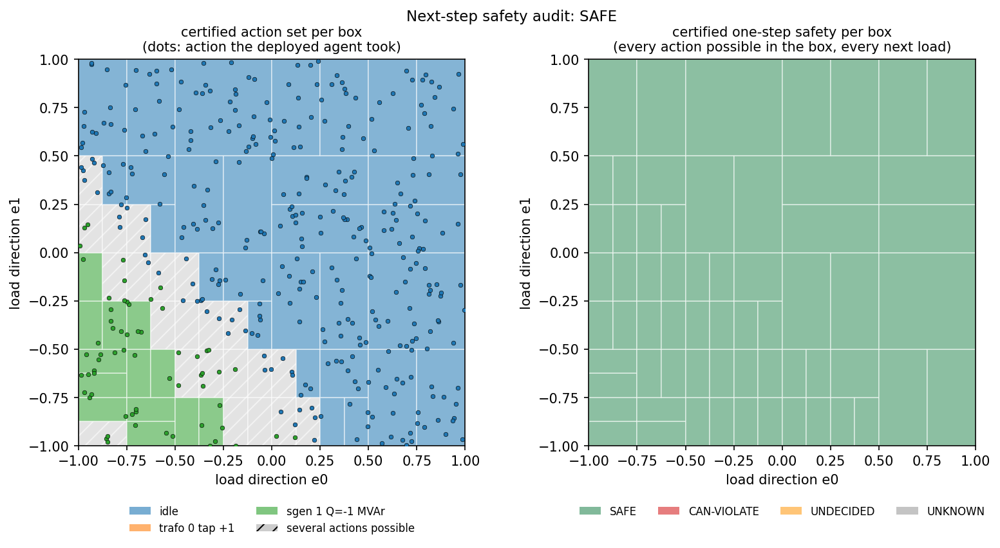

# RL mode 1: next-step safety

**Question:** the agent sees the grid at any load in a box around the current operating point. Which actions can it
take, and does each keep every limit one step later, for every next load?

## Usage

```python
rep = auditor.next_step(net, load_width=0.05)       # each load within +-5 % of the snapshot `net`
print(rep.summary())
rep.plot("next_step.png")                           # 2D map of the load set (needs >= 1 load direction)
```

| Option | Meaning |
|---|---|
| `uncertainty=LoadUncertainty(...)` | the load set: per load (`rel=`), all loads together (`directions="common"`), load modes (a matrix), or principal modes from data (`LoadUncertainty.from_samples`) |
| `next_load="same"` (default) | the action takes effect at any load in the same box |
| `next_load="step", step_change=0.01` | or at the observed load ±1 % (tighter, slower) |
| `refine="single"` | split until each box has one action (default `"safe"`: until every action is proven safe) |
| `Limits(n1=True)` | also check every line outage |

**Use few load directions.** Splitting works well in a few dimensions. With one direction per load the proof
still holds, but the certified action set gets larger than what the agent really does. The report shows how many of
the certified actions the agent actually took in random samples; a big gap means the set is too high-dimensional.

## How it works

1. **Pre-action grid:** Krawczyk certifies the power flow over the load box, and the observation vector is built from
   it. Every entry stays a function of the same loads.
2. **Agent:** the observation is pushed through the network, and the masked argmax gives every action it can take.
3. **Post-action grid:** each of those actions is certified over the next-load set. Every bus voltage, branch loading
   and the slack exchange are bounded, then checked against the limits.
4. **Splitting:** the box is split where several actions compete or an action cannot be proven safe.
5. **Checks:** for an action not proven safe, a search looks for a load where the agent really takes it and a limit
   is really violated. Random samples check the certified sets and bounds.

### From the load box to a correlated observation set

The uncertainty is only in the loads, written as a few symbols e (the load box). Every other quantity the agent
observes is computed **as a function of those same symbols**:

- **Loads:** an affine function of e (`load_p`, `load_q`).
- **Grid quantities:** voltages, loadings, flows and the slack exchange come from the certified power flow, as
  degree-2 polynomials in e plus a tiny remainder. The remainder is the only part not tied to e (about 1e-5 pu here).
- **Discrete state:** setpoints, taps and switch states are constants.

So the agent receives the **image of the load box** under the power flow, not a box per observation entry. The
entries move together the way the physics makes them move: more load means lower voltages and higher loadings,
never "high load and high voltage" at once. An independent box with the same per-entry ranges would contain such
impossible combinations, and the agent would look able to take actions it never takes.

On the feeder, with all loads moving together by ±10 % (one load symbol, 18 observation entries):

| Observation set fed to the agent | Symbols | Mean logit width | Actions it can take |
|---|---|---|---|
| correlated (what certflow does) | 2 | 10.4 | idle, absorb Q |
| independent box, same per-entry ranges | 18 | 21.5 | all 5 actions |

In random samples the agent only ever idles. One load symbol adds 0.2 MW to load 0 and removes 0.005 pu from bus 5's
voltage at the same time; the correlated set keeps that link.

The same correlated observation is used in mode 3 at every step. Mode 2 adds measurement noise on top, as separate
independent symbols.

## Example: the feeder, two load directions

The loads of buses 2–3 move together (e0), and so do those of buses 4–5 (e1), each by up to ±35 %.

<!-- report:rl_next_step -->
```text
NEXT-STEP SAFETY AUDIT  ->  SAFE
  loads: 2 uncertain directions, low-rank: 2 load modes around the snapshot; next load: anywhere in the same box
  limits: |V| in [0.95, 1.05] pu, loading <= 100%, N-0
  partition: 63 boxes; SAFE 100.0%  CAN-VIOLATE 0.0%  UNDECIDED 0.0%  PF-NOT-CERTIFIED 0.0%
  actions the agent can take (share of the load box) and their certified effect:
     89.06%  idle                               SAFE        |V| 0.9959..1.0357 pu, max loading 65.7%
     27.34%  sgen 1 Q=-1 MVAr                   SAFE        |V| 0.9884..1.0263 pu, max loading 71.4%
      0.78%  trafo 0 tap +1                     SAFE        |V| 0.9803..1.0207 pu, max loading 66.7%
  Monte-Carlo cross-check (400 samples): agent's action in certified set 400/400, post-action state inside certified bounds 400/400
    actions the agent actually took in the samples: 2 of the 3 certified reachable (idle, sgen 1 Q=-1 MVAr); the others are possible but rare, or bound looseness
  time 10.9s
```
<!-- /report -->



**Left: which action the agent can take where.** The boxes follow the agent's decision boundary.
- **Low loads (lower left):** voltages rise, and the agent absorbs reactive power at the PV park (green).
- **Elsewhere:** it idles (blue).
- **Hatched boxes:** both actions are possible there.
- **Dots:** the agent's actual choice at random loads. Every dot lies in its box's certified set.

**Right: safety.** Every action the agent can take, anywhere in the box, keeps every limit for every next load.
