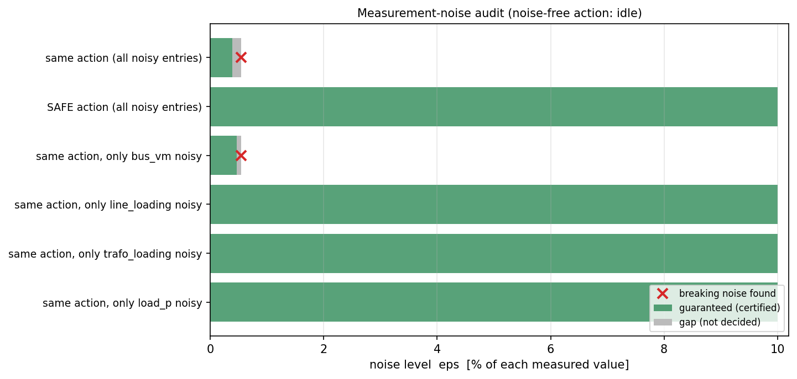

# RL mode 2: measurement noise

**Question:** at a known operating point the agent reads the grid through noisy sensors. How much noise can it take
before it acts differently, and before it can pick an action that violates a limit?

## Usage

```python
nr = auditor.noise_robustness(net, eps_max=0.10)    # noise up to 10 % of each measured value
print(nr.summary())
nr.plot("noise.png")
```

| Option | Meaning |
|---|---|
| `noisy=["bus_vm", "line_loading"]` | which observation blocks are noisy (default: all measurement blocks; the agent's own setpoints, taps and switch states are exact) |
| `relative=False` | absolute noise in the observation's units instead of a fraction of each value |
| `step_change=0.01` | the action takes effect after the loads moved by up to ±1 % |

## How it works

Every noisy entry gets its own bounded noise term, |noise_i| ≤ ε·|value_i|, as a new independent symbol. The grid itself is exact here (the snapshot); with `step_change`, the noise is added on top of the
[correlated observation set](rl_next_step.md#from-the-load-box-to-a-correlated-observation-set).

- **Guaranteed level:** the largest ε for which the proof holds. It is found by bisection; at each ε the noisy
  observation set is pushed through the agent.
- **Found level:** the smallest ε at which an attack finds a concrete noise vector that breaks the requirement. For
  "safe action", the action it causes must really violate a limit (checked with a plain power flow).

The true value lies between the two numbers. If the requirement cannot be proven even without noise (the agent's
decision is already ambiguous, or its action already unsafe), the report says so instead of claiming 0 %.

## Example: the feeder snapshot

<!-- report:rl_noise -->
```text
MEASUREMENT-NOISE AUDIT  (noise on 15 of 18 observation entries, relative to each value; exact entries: sgen_q, trafo_tap)
  noise-free action: idle
  same action:  guaranteed up to 0.39%   |  smallest noise found that changes it: 0.54% (makes it pick sgen 1 Q=-1 MVAr)
  safe action:  guaranteed up to 10.00% (whole range)   |  smallest noise found that makes it pick an unsafe action: none found up to 10.00%
  per observation group (only that group noisy), same action:
     bus_vm           guaranteed >= 0.47%                 breaks at 0.54%
     line_loading     guaranteed >= 10.00% (whole range)  no break found
     trafo_loading    guaranteed >= 10.00% (whole range)  no break found
     load_p           guaranteed >= 10.00% (whole range)  no break found
  actions the agent can pick at fixed noise levels:
     +-  1.00%: idle | trafo 0 tap +1 | trafo 0 tap -1 | sgen 1 Q=-1 MVAr | sgen 1 Q=0 MVAr   all safe
     +-  2.00%: idle | trafo 0 tap +1 | trafo 0 tap -1 | sgen 1 Q=-1 MVAr | sgen 1 Q=0 MVAr   all safe
     +-  5.00%: idle | trafo 0 tap +1 | trafo 0 tap -1 | sgen 1 Q=-1 MVAr | sgen 1 Q=0 MVAr   all safe
     +- 10.00%: idle | trafo 0 tap +1 | trafo 0 tap -1 | sgen 1 Q=-1 MVAr | sgen 1 Q=0 MVAr   all safe
  time 1.2s
```
<!-- /report -->



How to read it:

- **Same action:** the agent changes its action at about 0.5 % noise on the voltage measurements. That is a real
  noise vector; the guarantee (0.39 %) is close to it.
- **Other groups:** noise on loadings or loads does not change the action up to 10 %.
- **Safe action:** whatever the agent picks under up to 10 % noise is still safe. Noise makes it act differently,
  but not dangerously.

**Not covered:** other operating points (combine with mode 1), and noise that is correlated over time.
